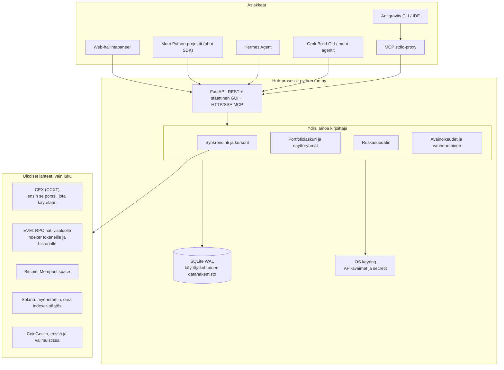

# OmatKryptoLompakot - Arkkitehtuuri ja toteutussuunnitelma

Tämä dokumentti määrittelee **OmatKryptoLompakot** -järjestelmän arkkitehtuurin, teknologiat, tietomallin ja vaiheittaisen toteutussuunnitelman. Järjestelmä on moniketjuinen ja monipörssinen lompakko- ja portfoliokeskitin (hub), jolla on puhtaasti **lukuoikeudet** (read-only) käyttäjän varoihin. Sitä voidaan käyttää hallinta-GUI:sta, toisista ohjelmointiprojekteista (Python SDK / REST) sekä tekoälyagenttiympäristöistä (Antigravity CLI, Hermes Agent, Grok CLI jne. MCP-standardin kautta).

Päätösten perustelut ovat tiedostossa [PAATOKSET_JA_SUUNNITTELUHISTORIA.md](PAATOKSET_JA_SUUNNITTELUHISTORIA.md). Suunnitelmaa edeltävä arvio on tiedostossa [KOMMENTIT.md](KOMMENTIT.md). Tämä dokumentti on päivitetty 2026-10-13 sen arvion mukaan.

---

## 1. Yleiskatsaus ja keskeiset periaatteet

1. **Vain lukuoikeudet (Read-Only):** Ei yksityisavaimia (private keys) tai siirto-oikeuksia. Ainoastaan julkisia lohkoketjuosoitteita ja CEX-pörssien lukuoikeudellisia API-avaimia. Yhteystesti lukee avaimen todelliset oikeudet ja varoittaa, jos avain saa treidata tai tehdä noston.
2. **Käytettävyys taustalla toimiville agenteille:** Paikallinen SQLite ilman master-salasanaa. API-avaimet ja secretit ovat käyttöjärjestelmän keyringissä (Windows DPAPI, Linux Secret Service), joka aukeaa kirjautuneelle käyttäjälle ilman erillistä kyselyä. SQLiteen jää viite ja metatieto.
3. **Yksi kirjoittaja:** `python run.py` omistaa tietokantakirjoitukset, synkronoinnin, REST-rajapinnan, hallintapaneelin ja HTTP/SSE-MCP:n. IDE:n käynnistämä `stdio`-MCP on erillinen ohut proxy, joka kutsuu hubia HTTP:llä.
4. **Moniporttinen rajapinta (Triad Interface):**
   - **REST API:** Standardi HTTP-rajapinta mille tahansa koodille.
   - **MCP Server:** HTTP/SSE hubin prosessissa. Erillinen stdio-proxy niille asiakkaille, jotka käynnistävät MCP:n aliprosessina.
   - **Python SDK:** Ohut HTTP-asiakas. Muut projektit eivät saa riippuvuudekseen `ccxt`- tai `web3`-kirjastoa.
5. **Resurssitehokkuus ja tilauspohjainen AI:** Ei erillistä pay-per-token API-laskutusta tekoälylle. Päättely tapahtuu käyttäjän olemassa olevassa kuukausitilauksessa (Google AI Pro Antigravityssä, SuperGrok / Grok CLI tai Hermes-malli).
6. **Siirrettävyys (Cross-Platform):** Sama koodi Windowsissa ja Ubuntussa. Hub käynnistyy komennolla `python run.py`.
7. **Verkkokuuntelu:** Hub kuuntelee oletuksena osoitetta `0.0.0.0` ja porttia `8000`, jotta lähiverkon muut koneet ja agentit voivat kutsua sitä. Asiakkaat käyttävät säädettävää base URL -osoitetta.
8. **Välimuisti ensin:** Agentit ja GUI lukevat SQLitesta. Verkkohaku tapahtuu taustasynkronoinnissa, lähdekohtaisella cooldownilla.
9. **Määrät ja hinnat erikseen:** Saldoon tallennetaan määrä. Fiat-arvo lasketaan lukutilanteessa `prices`-taulusta. Puuttuva kurssi ei peitä saldoa.

---

## 2. Järjestelmäarkkitehtuuri



Stdio-proxy käynnistyy vain, kun IDE tai muu asiakas sitä pyytää. Se ei avaa tietokantaa kirjoitettavaksi. HTTP/SSE-MCP palvelee samasta hub-prosessista kuin REST.

---

## 3. Komponentit ja moduulit

### 3.1. Tietokerros (Database & Storage)

Tietokanta on SQLite WAL-tilassa. Oletuspolku on repossa ulkopuolella:

- Windows: `%LOCALAPPDATA%\OmatKryptoLompakot\wallets.db`
- Linux: `~/.local/share/omatkryptolompakot/wallets.db`

Polku ylikirjoitetaan `config.yaml`-tiedoston `database`-avaimella. Kaikki aikaleimat ovat UTC. Määrät tallennetaan desimaalimerkkijonoina, ei liukulukuina.

`schema_version` ja lyhyet migraatiot kuuluvat tietokerrokseen heti ensimmäisestä skeemasta alkaen.

**Taulut:**

- `accounts`: Yhteys. Tyyppi `cex` tai `onchain`, nimi, venue (esim. `binance`, `ethereum`), viimeisin onnistuminen, viimeisin virhe ja virheen laji (`ok`, `auth_failed`, `rate_limited`, `network`).
- `cex_credentials`: Viite keyringiin, avaimen loppu näkyvänä vihjeenä, permission-liput (`can_read`, `can_trade`, `can_withdraw`), `created_at`, `expires_at` (tyhjä, kunnes pörssi tai käyttäjä antaa päivän), `expiry_source` (`exchange` tai `user`).
- `wallets`: Tili, ketju, julkinen osoite, lempinimi, seuranta päällä tai pois.
- `assets`: Ketju, sopimusosoite tai mint (tyhjä natiivikolikolle), symboli näyttönimenä, desimaalit, CoinGecko-tunniste, `display_group` (esim. `ETH`).
- `balances`: Tili, valinnainen lompakko, omaisuus, laji (`spot`, `earn`, `funding`, `wallet`), määrä, päivitysaika. Versio 1 näyttää spot- ja lompakkosaldot. Earn ja funding tallennetaan omiin lajeihinsa heti, jos lähde ne erottelee.
- `prices`: Omaisuus, noteeraus (`EUR` tai `USD`), hinta, hakuaika. Arvo lasketaan lukutilanteessa. Puuttuva rivi jättää fiat-arvon tyhjäksi ja määrän näkyviin.
- `transactions`: Lähde, ketju, hash, logi- tai tapahtumaindeksi, UTC-aika, laji (`transfer`, `trade`, `deposit`, `withdrawal`, `approval`, `other`), roskalippu, roska-syy, normalisoidut kentät (lähtö, kohde, omaisuus, määrä, fee) ja raaka vastaus `raw_json`. Uniikki avain on lähde + ketju + hash + indeksi. Versiossa 1 yksi normalisoitu rivi riittää, koska raakavastaus säilyy.
- `sync_state`: Lähde, kursori, viimeisin lohko tai ledger-id, historiaksi haettu aikaväli, backfill valmis, viimeisin saldopäivitys, viimeisin transaktiopäivitys.
- `sync_runs`: Ajo, lähde, alku, loppu, tila, virhe, edistyminen. GUI näyttää viimeisen virheen tästä.
- `token_overrides`: Ketju, sopimus tai mint, päätös `allow` tai `deny`, muistiinpano. Käyttäjän merkintä voittaa automaattisen suodattimen.
- `settings`: Noteerausvaluutta (oletus EUR), synkronointivälit, näyttöryhmien valinnat, indexer-avainten keyring-viitteet.

**Näyttöryhmät.** Raakasaldot säilyvät sellaisina kuin lähde ne antaa. Aggregaattori kokoaa saman `display_group`-arvon yhteen. Oletusryhmä ETH sisältää ETH:n ja WETH:n. stETH ja vastaavat kääreet liittyvät ryhmään vain, jos käyttäjä kytkee sen päälle. Ne eivät ole sama positio.

### 3.2. Salaisuudet

Keyring-palvelun nimi on `omatkryptolompakot`. Sinne tallennetaan CEX API key, API secret ja valinnaiset indexer-avaimet. Tietokannassa on vain viite. Keyring aukeaa kirjautuneelle käyttäjälle, joten taustasynkronointi ja toisten projektien kutsut toimivat ilman master-salasanan kyselyä.

### 3.3. CEX-integraatiokerros (CCXT)

CCXT on yhteinen kirjasto. Ensimmäinen toteutettava adapteri on se pörssi, jota käyttäjä oikeasti käyttää. `fetch_balance` on usein yhteinen. Sivutus, talletukset, nostot, ledger ja avainoikeudet testataan adapterikohtaisesti tallennetuilla JSON-fixtureilla.

**Oikeudet ja vanheneminen:**

- Yhteystesti lukee pörssin permission-liput.
- Jos avain saa treidata tai tehdä noston, tila on punainen, vaikka hub ei tekisi kumpaakaan kutsua.
- `expires_at` kirjoitetaan vain pörssin palauttamasta päivästä tai käyttäjän asettamasta päivästä.
- Tila viimeisestä kutsusta: ok, tunnistautuminen epäonnistui, rate limit, verkko.

**Värit hallintapaneelissa ja agentin varoituksissa:**

- Vihreä: viimeisin kutsu ok, oikeudet ovat lukuoikeudet, ja `expires_at` puuttuu tai siihen on yli 14 päivää.
- Keltainen: `expires_at` on olemassa ja siihen on enintään 14 päivää, tai viimeisin häiriö on rate limit tai verkko.
- Punainen: tunnistautuminen epäonnistui, avain on vanhentunut, tai avaimella on trade- tai nosto-oikeus.

### 3.4. On-chain -integraatiokerros

Jokaiselle ketjulle nimetään `config.yaml`:ssa ensisijainen indexer. Liitinrajapinta on moniketjuinen heti. Toteutus etenee pystysuorana siivuna, ei kaikkia ketjuja kerralla.

- **EVM, natiivisaldo:** Julkinen RPC.
- **EVM, tokenit ja historia:** Indexer. Blockscout sillä ketjulla, jonka instanssi on luotettava. Käyttäjän syöttämä Etherscan-yhteensopiva tai Alchemy-avain on varapolku ja korkeampien rajojen polku. Avain säilyy keyringissä. Julkinen RPC ei ole ERC-20-listan lähde.
- **Ensimmäinen EVM-ketju:** Se ketju, jota käyttäjä oikeasti käyttää.
- **Bitcoin:** Mempool.space / Blockstream Esplora. Toinen toteutettava ketju ensimmäisen siivun jälkeen.
- **Solana:** Toteutetaan siivun ja Bitcoinin jälkeen. Historia tarvitsee ennen toteutusta valitun indexerin. Julkinen RPC on vain ehdokas natiivi- ja SPL-saldoille, ja se rajoittaa kuormitettuna. Solscania ei oleteta vapaaksi tai vakaaksi rajapinnaksi.

### 3.5. Hinnat

CoinGecko-haut tehdään erissä ja tallennetaan `prices`-tauluun. Tuntemattoman sopimuksen "ei löydy" -tulos välimuistetaan, jotta roskatokeneita ei kysytä yksitellen. Jos kurssi puuttuu, määrä näytetään ilman fiat-arvoa.

### 3.6. Roskatransaktioiden ja -tokenien suodatin

Oletussäännöt versiossa 1:

- Tuntematon sopimus tai mint, jolle ei ole kurssia, merkitään roskaksi.
- Nolla-arvoinen mainos- tai pölysiirto merkitään roskaksi.
- Syy tallennetaan `spam_reason`-kenttään.
- `token_overrides` voittaa säännön.
- Negatiivinen kurssihaku välimuistetaan.

Approvalit ovat lajia `approval`. Ne näkyvät oletuksena, eivätkä ne kuulu roskasuodattimen piilotukseen. GUI:n valitsin *Piilota roskatransaktiot* ja agenttikyselyn `include_spam` koskevat roskalippua. Approvalit pysyvät näkyvissä, kunnes käyttäjä suodattaa lajin erikseen.

### 3.7. Synkronointi

- Lukijat saavat vastauksen SQLitesta.
- Manuaalinen päivitys: koko portfolio tai yksi yhteys.
- Ajastettu päivitys: saldot oletuksena tunnin välein. Transaktiohistoria harvemmin, oletuksena kuuden tunnin välein tai vain pyynnöstä.
- Cooldown on lähdekohtainen, oletus 5 minuuttia. Yhden lähteen päivitys ei estä toista. Rajoitus on palvelimella, myös `trigger_sync`-työkalussa.
- Ensimmäinen historia rajataan oletuksena viimeisiin 90 päivään. Ajo jatkuu `sync_state`-kursorista keskeytyksen jälkeen. Edistyminen näkyy `sync_runs`-taulussa ja GUI:ssa.
- Vanhempi historia on myöhempi erillinen backfill.

---

## 4. Rajapinnat ulkoisille projekteille ja AI-agenteille

Kaikki kolme rajapintaa kutsuvat samaa ydintä. Reitit ja MCP-työkalut eivät sisällä omaa laskentaa.

### 4.1. HTTP/SSE MCP ja stdio-proxy

HTTP/SSE-MCP käynnistyy hubin mukana. Stdio-proxy on komento, jonka IDE käynnistää ja joka välittää kutsut hubin HTTP-rajapintaan.

Työkalut palauttavat tiiviin JSONin. Mukana ovat `as_of` (datan ikä UTC-aikana) ja `warnings` (vanheneva avain, liian leveät oikeudet, epäonnistunut synkronointi, puuttuva kurssi). Transaktiolistalla on oletusrivikatto 50 ja kursori.

- `get_total_portfolio()`: kokonaisarvo noteerausvaluutassa, erittely omaisuusryhmittäin ja lähteittäin, varoitukset.
- `get_balances_by_source(source_type, source_name)`: yhden pörssin tai osoitteen saldot.
- `get_transactions(chain, venue, address, time_from, time_to, include_spam, limit, cursor)`: erilliset parametrit, ei yhtä vapaamuotoista suodatinoliota.
- `check_connection_health()`: yhteyksien tila, oikeudet ja `expires_at`, jos se on olemassa.
- `trigger_sync(target)`: käynnistää taustapäivityksen. Lähdekohtainen cooldown pätee myös tähän.

### 4.2. Hermes Agent ja Antigravity

Valmiit konfiguraatiot tulevat sen jälkeen, kun HTTP-MCP vastaa ensimmäisen siivun työkaluihin.

- Hermes: `hermes/agent_config.json`
- Antigravity: `antigravity/skill_definition.md`

Kummassakin kuvataan hubin base URL ja se, että päättely jää isäntäohjelman tilaukseen.

### 4.3. Python SDK

Asiakas on ohut HTTP-kirjasto:

```python
from omat_krypto_lompakot.client import CryptoHubClient

hub = CryptoHubClient(base_url="http://127.0.0.1:8000")
portfolio = hub.get_portfolio()
print(portfolio.total_eur)
```

Oletusosoite on paikallinen hub. Toinen kone käyttää hubin koneen osoitetta, esimerkiksi `http://192.168.1.20:8000`. SDK ei avaa SQLitea eikä keyringiä.

---

## 5. Web-hallintapaneeli

GUI on staattinen sivu (HTML, Tailwind CSS, JavaScript), jonka FastAPI tarjoaa. Selain avaa hubin koneella `http://127.0.0.1:8000`. Lähiverkon muu kone käyttää hubin koneen osoitetta. Erillistä Node-prosessia ei tarvita ajonaikana.

### Päänäkymät

1. **Yhteydet**
   - CEX-kortti: pörssi, oikeudet, vanhenemispäivä vain jos se on tiedossa, jäljellä olevat päivät vain jos `expires_at` on olemassa, viimeisin virhe, "Testaa yhteys", "Päivitä".
   - On-chain -kortti: ketju, osoite, lempinimi, viimeisin synkronointi ja mahdollinen virhe.
   - "Lisää uusi yhteys" -modaali tuetuille pörsseille ja ketjuille sitä mukaa kuin liittimet valmistuvat.
2. **Portfolio**
   - Kokonaisarvo oletusvaluutassa. Toinen valuutta näytetään, kun sen kurssit ovat olemassa.
   - Allokaatio näyttöryhmittäin.
   - Jaottelu säilytyspaikan mukaan: CEX spot, on-chain, ja myöhemmin earn / funding kun ne otetaan näkyviin.
   - Rivi ilman kurssia näyttää määrän ja tyhjän arvon.
3. **Transaktiot**
   - Suodatus: ketju, pörssi, osoite, aikaväli, laji.
   - Valitsin *Piilota roskatransaktiot*.
   - Haku hashilla tai symbolilla.
   - Käyttäjä voi merkitä tokenin sallituksi tai kielletyksi. Merkintä kirjoittaa `token_overrides`-rivin.

---

## 6. Asetukset

`config.yaml` on käynnistysasetus:

- `bind`: oletus `0.0.0.0`
- `port`: oletus `8000`
- `database`: tyhjä tarkoittaa käyttöjärjestelmän oletuspolkua
- ensisijainen indexer per ketju
- ensimmäisen käynnistyksen oletukset synkronointiväleille, cooldownille ja historiaikkunalle

Käynnistyksen jälkeen GUI lukee ja kirjoittaa käyttäjän asetukset SQLiteen: noteerausvaluutta, synkronointivälit, näyttöryhmät ja indexer-avainten viitteet. Keyringissä ovat itse salaisuudet. Samoja käyttäjäasetuksia ei ylläpidetä kahtena rinnakkaisena totuutena `config.yaml`:ssa.

---

## 7. Tiedostorakenne

```text
OmatKryptoLompakot/
├── README.md
├── SUUNNITELMA.md
├── PAATOKSET_JA_SUUNNITTELUHISTORIA.md
├── KOMMENTIT.md
├── pyproject.toml
├── config.yaml                     # bind, portti, tietokantapolku, indexer-oletukset
├── run.py                          # hub: FastAPI + GUI + HTTP/SSE MCP, ainoa kirjoittaja
├── .gitignore                      # *.db, wal, shm, paikalliset salaisuudet
├── src/
│   └── omat_krypto_lompakot/
│       ├── __init__.py
│       ├── client.py               # ohut HTTP-SDK
│       ├── secrets/
│       │   └── keyring_store.py
│       ├── db/
│       │   ├── database.py
│       │   ├── models.py
│       │   └── migrations.py
│       ├── connectors/
│       │   ├── cex/
│       │   │   ├── ccxt_client.py
│       │   │   └── permissions.py  # oikeudet ja expires_at
│       │   ├── onchain/
│       │   │   ├── evm.py
│       │   │   ├── bitcoin.py
│       │   │   └── solana.py       # myöhempi vaihe
│       │   └── pricing/
│       │       └── coingecko.py
│       ├── services/
│       │   ├── sync_service.py
│       │   ├── aggregator.py
│       │   └── spam_filter.py
│       ├── api/
│       │   ├── server.py
│       │   └── routes.py
│       ├── mcp/
│       │   ├── http_server.py      # osa hub-prosessia
│       │   └── stdio_proxy.py      # erillinen prosessi
│       └── web/
│           ├── static/
│           └── templates/
├── tests/
│   ├── fixtures/
│   ├── test_aggregator.py
│   └── test_spam_filter.py
├── hermes/
│   └── agent_config.json
└── antigravity/
    └── skill_definition.md
```

`.gitignore` sulkee `*.db`, `*.db-wal`, `*.db-shm` ja paikalliset salaisuustiedostot ennen ensimmäistä oikeaa API-avainta. Tietokannan oletuspolku on silti käyttäjän datahakemisto, ei repo.

---

## 8. Testaus

Liittimiä testataan tallennetuilla JSON-fixtureilla. Aggregaattorilla ja roskasuodattimella on kiinteät esimerkit: näyttöryhmä ETH+WETH, puuttuva kurssi, käyttäjän override, approval näkyvissä vaikka roskasuodatin on päällä. Elävää pörssiä ei kutsuta joka testiajolla.

Windows- ja Ubuntu-ajo tarkistetaan siivun jälkeen: käynnistys, keyring, tietokantapolku ja kutsu toiselta koneelta osoitteeseen `0.0.0.0`-sidottuun porttiin.

---

## 9. Toteutuksen vaiheet

Modulaarinen liitinrajapinta tehdään heti. Yksi polku toimii päästä päähän ennen seuraavaa ketjua tai pörssiä.

1. **Runko.** Virtuaaliympäristö, `pyproject.toml`, `.gitignore`, `config.yaml` (`bind: 0.0.0.0`), SQLite oletuspolkuineen, `schema_version`, migraatiot, keyring-varasto.
2. **Ensimmäinen siivu.** Yksi oikeasti käytetty CEX-adapteri ja yksi oikeasti käytetty EVM-ketju. Saldot, hinnat, kursorillinen synkronointi, yhteystesti oikeuksineen. REST: portfolio ja yhteydet.
3. **Minimaalinen GUI** tälle siivulle: yhteyden tila, saldo, viimeisin synkronointivirhe.
4. **Historia.** Transaktiot, 90 päivän oletusikkuna, jatkaminen keskeytyksestä, roskasuodatin, approvalit omana lajinaan, `token_overrides`, `sync_runs`.
5. **Asiakkaat.** HTTP-MCP tiiviillä vastauksilla, stdio-proxy, ohut Python-SDK.
6. **Bitcoin** Mempool.spacen kautta.
7. **Lisää EVM-ketjuja ja pörssejä** yksi kerrallaan, kun edellinen fixture-testi on vihreä.
8. **Solana**, sen jälkeen kun indexer on valittu.
9. **Hermes- ja Antigravity-konfiguraatiot** sekä ristiinajo Windowsissa ja Ubuntussa.

Avoimet valinnat toteutuksen alussa: mikä pörssi ja mikä EVM-ketju ovat ensimmäinen siivu. Solanan indexer valitaan vaiheessa 8, ei sitä ennen.
